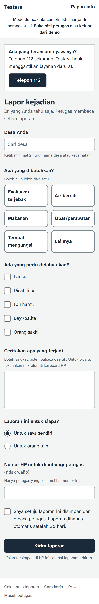
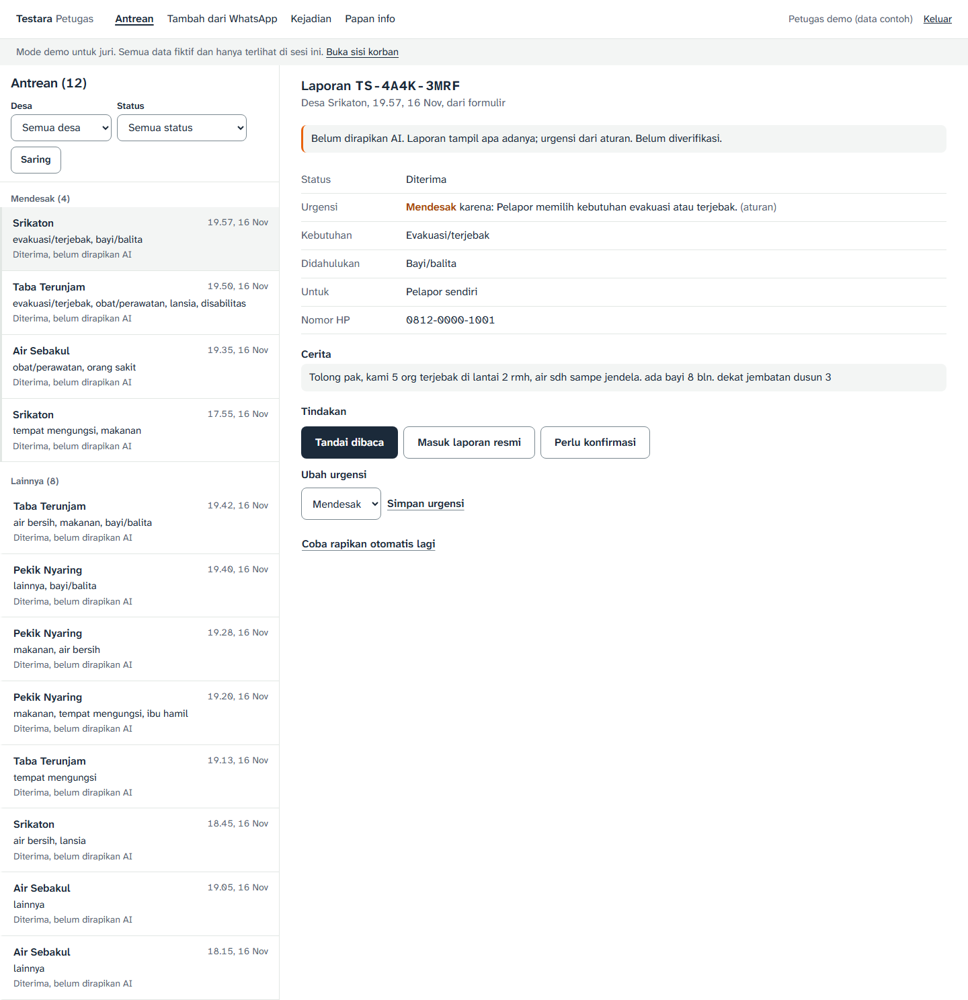
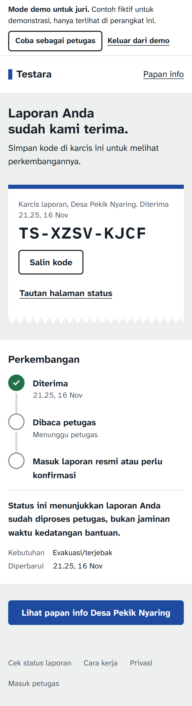
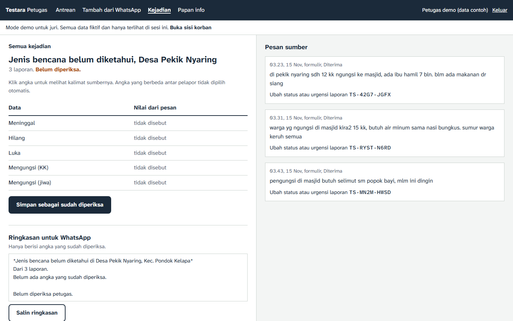
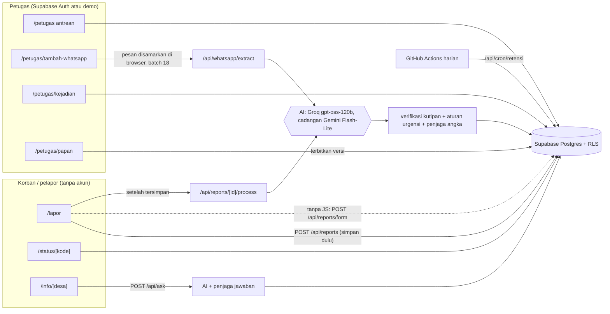

# TESTARA: Platform Respons Bencana Dua Arah Berbasis AI untuk Pelaporan Korban Tanpa Aplikasi, Prioritas Penanganan Kelompok Rentan, dan Informasi Posko Terverifikasi

Saat bencana, korban dan keluarganya tidak tahu harus melapor ke mana, tidak tahu apakah laporannya dibaca, dan menerima kabar simpang siur soal pengungsian dan bantuan. Di sisi lain, petugas BPBD dan posko yang jumlahnya terbatas menerima laporan berulang dengan angka berbeda dari banyak arah, termasuk grup WhatsApp kepala desa, lalu membacanya satu per satu. Bencana sangat sering terjadi: sepanjang 2025 BNPB mencatat 3.233 kejadian bencana ([Indonesia Baik](https://indonesiabaik.id/infografis/indonesia-tangguh-menghadapi-bencana-2025)), dan angka korban sering dikoreksi belakangan, misalnya koreksi data banjir Sumatra menjadi 770 meninggal dan 462 hilang pada 3 Desember 2025 ([CNN Indonesia](https://www.cnnindonesia.com/nasional/20251203190705-20-1302487/bnpb-koreksi-data-korban-banjir-sumatra-770-meninggal-462-hilang)).

Testara (dari kata Latin *testis*, saksi) membuat korban cukup bercerita dengan cara paling mudah, lalu tahu bahwa ceritanya sampai, ditangani, dan dibalas dengan informasi yang benar. Petugas mendapat antrean yang mendahulukan kelompok rentan dan angka yang setiap nilainya punya kalimat sumber.

Dibuat untuk Lomba Web Development IT RUSH 2026, subtema Mitigasi Bencana dan Perubahan Iklim.

## Coba dalam 2 menit

Tautan live: _diisi setelah deploy Vercel_.

1. Di beranda, tekan **Coba sebagai korban**. Pilih desa, centang "Lansia", tulis cerita santai, kirim. Kode laporan muncul.
2. Tekan **Buka sisi petugas** di pita demo. Laporan Anda ada di urutan atas bagian "Mendesak" beserta alasannya.
3. Tekan **Tandai dibaca** dan **Masuk laporan resmi**, buka **Kejadian** untuk memeriksa angka, lalu **Papan info** untuk menerbitkan papan desa.
4. Buka lagi halaman status (kode Anda): linimasa sudah bergerak. Di papan info desa, tanya "posko terdekat?".

Mode demo memakai cookie sesi: semua data hanya terlihat di perangkat Anda, terisi 12 laporan contoh fiktif dan papan info untuk 2 desa, dan dihapus setelah 24 jam. Data contoh: kejadian dan orang fiktif, nama desa nyata di Kabupaten Bengkulu Tengah, nomor HP palsu `0812-0000-xxxx`. **Contoh fiktif untuk demonstrasi.**

## Tangkapan layar

| Sisi korban (375 px) | Sisi petugas (1440 px) |
|---|---|
|  |  |
|  |  |

Semua tangkapan layar (375 px dan 1440 px) ada di [`docs/screenshots/`](docs/screenshots). Rencana desain dan kritiknya: [`docs/DESIGN.md`](docs/DESIGN.md).

## Arsitektur



Prinsip yang dipegang: **laporan disimpan dulu, AI belakangan.** Route simpan tidak pernah memanggil AI, sehingga laporan tidak gagal walau kuota AI habis.

## Cara AI dipakai dan batasannya

| Alur | Masukan ke AI | Penjaga deterministik |
|---|---|---|
| Rapikan laporan warga | Cerita tersamar + pilihan formulir | Kutipan wajib substring cerita; angka hitungan wajib ada di kutipannya; ringkasan dengan angka tanpa saksi diganti template; urgensi AI hanya boleh menaikkan |
| Pesan WhatsApp | Isi pesan tersamar (nama pengirim tidak dikirim) | Sama seperti di atas; pesan "siap pak", stiker, dan terusan peringatan cuaca tidak dijadikan laporan |
| Usulan papan info | Laporan desa yang sudah resmi | Usulan tanpa kutipan atau dengan angka tanpa saksi dibuang; petugas yang menyunting dan menerbitkan |
| Tanya papan info | Pertanyaan + JSON papan terbit desa itu dan desa sekecamatan | Setiap butir rujukan harus ada; setiap angka, jam, dan nama tempat di jawaban harus muncul di butir yang dirujuk; jika gagal: "Belum ada informasi resmi untuk itu" + kontak posko + butir relevan |

- **Aturan urgensi** ada di kode (`src/lib/triage/`), bukan di LLM. Urgensi minimal "tinggi" jika kebutuhan evakuasi dipilih, jika ada orang yang perlu didahulukan bersama kebutuhan evakuasi atau obat, atau jika cerita memuat kata bahaya (terjebak, tidak bisa keluar, hanyut, tertimbun, sesak napas, pingsan, luka parah, pendarahan, beserta singkatan dan salah ketik umum seperti "tdk bisa keluar", "trjebak"). Sumber urgensi disimpan: `aturan`, `ai`, atau `petugas`.
- **Ketahanan**: cache sha256 (teks tersamar + versi prompt + model), anggaran harian global (`DAILY_AI_REQUEST_BUDGET`), fallback otomatis Groq ke Gemini saat 429, 5xx, atau timeout 25 detik, validasi Zod dengan satu kali ulang. Batas laju per IP (di-hash): 5 laporan, 10 proses WhatsApp, 20 pertanyaan per jam.
- **Batasan**: AI bisa salah membaca konteks, singkatan daerah, atau angka yang disebut tidak langsung. Karena itu semua hasil diberi label "Dirapikan otomatis. Periksa sebelum ditindaklanjuti." dan angka yang berbeda antar pelapor tidak pernah dipilih otomatis.
- **Hasil evaluasi**: lihat [`eval/RESULTS.md`](eval/RESULTS.md). Saat README ini ditulis, evaluasi **belum dijalankan** karena kunci AI belum tersedia, jadi belum ada angka akurasi yang bisa dikutip. Jalankan `npm run eval` setelah kunci diisi.

## Menjalankan secara lokal

Butuh Node.js 22.

```bash
npm install
```

```bash
cp .env.example .env.local
```

```bash
npm run dev
```

Tanpa Supabase, aplikasi memakai penyimpanan memori (data hilang saat server dimulai ulang) dan mode demo tetap berjalan. Tanpa kunci AI, laporan tetap tersimpan dengan urgensi dari aturan.

Perintah lain:

| Perintah | Isi |
|---|---|
| `npm run lint` / `npm run typecheck` / `npm test` / `npm run build` | Gerbang setiap fase dan CI |
| `npm run test:e2e` | Playwright: alur demo juri, tanpa sinyal, Slow 3G, tanpa JavaScript, batas laju |
| `npm run screenshots` | Tangkapan layar 375 px dan 1440 px ke `docs/screenshots/` |
| `npm run eval` | Evaluasi akurasi dengan AI sungguhan, menulis `eval/RESULTS.md` |
| `npm run demo:generate` | Menjalankan AI sungguhan atas data contoh, menulis `data/demo/ai-results.json` |

### Variabel lingkungan

| Nama | Isi |
|---|---|
| `GROQ_API_KEY`, `GEMINI_API_KEY` | Kunci penyedia AI (server saja). `GEMINI_MODEL` opsional, bawaan `gemini-3.5-flash-lite` |
| `SUPABASE_URL` | URL proyek Supabase |
| `SUPABASE_ANON_KEY` | Kunci publishable (`sb_publishable_...`), dipakai untuk sesi masuk petugas |
| `SUPABASE_SERVICE_ROLE_KEY` | Kunci secret (`sb_secret_...`), hanya di server |
| `DAILY_AI_REQUEST_BUDGET` | Batas panggilan AI per hari (bawaan 300) |
| `IP_HASH_SALT` | Garam hash IP untuk batas laju |
| `CRON_SECRET` | Rahasia route retensi |
| `EMERGENCY_NUMBER_LABEL` | Nomor darurat yang tampil (bawaan 112) |
| `POSKO_WHATSAPP_NUMBER` | Nomor WhatsApp posko untuk cadangan laporan (bawaan nomor contoh) |
| `REGENCY_CODE` | Kode kabupaten layanan (bawaan `17.09`, Bengkulu Tengah) |

Tidak ada kunci rahasia yang memakai awalan `NEXT_PUBLIC_`.

### Basis data dan akun petugas

1. Buat proyek Supabase, lalu jalankan [`supabase/migrations/20261115000000_init.sql`](supabase/migrations/20261115000000_init.sql) (SQL Editor atau `supabase db push`).
2. Tidak ada pendaftaran publik. Admin membuat akun di Supabase Dashboard (Authentication, Add user, centang auto confirm), lalu mendaftarkannya sebagai petugas:

   ```sql
   insert into public.staff (user_id, name, regency_code)
   values ('<uuid pengguna>', 'Nama Petugas', '17.09');
   ```

3. Untuk retensi harian, isi secret repo GitHub `APP_URL` dan `CRON_SECRET` (workflow `.github/workflows/retensi.yml`).

## Keamanan, privasi, dan retensi

- Publik tidak membaca atau menulis tabel langsung; semua lewat route handler server dengan kunci secret. RLS aktif tanpa policy untuk `anon`, dan petugas login hanya bisa membaca data kabupatennya.
- Setiap query membawa lingkup `{ sesi demo, kabupaten }`, jadi data demo tidak pernah tercampur dengan data sungguhan atau sesi demo lain.
- Halaman publik tidak memuat nama atau nomor HP. Nomor HP pelapor hanya terlihat petugas dan tidak pernah dikirim ke AI. Nomor di dalam teks disamarkan (`[nomor disamarkan]`) di browser sebelum dikirim dan sekali lagi di server.
- Log hanya berisi metadata (tugas, penyedia, durasi, hasil), tidak pernah isi laporan.
- Laporan dihapus otomatis setelah 30 hari; data demo setelah 24 jam.
- Detail: halaman `/privasi` dan [`docs/DECISIONS.md`](docs/DECISIONS.md).

## Sumber data dan lisensi

- Data wilayah: [cahyadsn/wilayah](https://github.com/cahyadsn/wilayah) (MIT), berbasis Kepmendagri kode wilayah 2025, subset Provinsi Bengkulu. Rincian dan teks lisensi: [`data/wilayah/SOURCE.md`](data/wilayah/SOURCE.md).
- Font: Atkinson Hyperlegible Next dan Atkinson Hyperlegible Mono oleh Braille Institute (SIL Open Font License 1.1), di-host sendiri lewat `next/font`.
- Library utama: Next.js, React, Tailwind CSS, Zod, Fuse.js, @supabase/supabase-js, @supabase/ssr (semuanya MIT atau Apache-2.0). Pengujian: Vitest, Playwright.

## Tools dan model AI

- **Dalam produk**: Groq `openai/gpt-oss-120b` (utama) dan Google Gemini `gemini-3.5-flash-lite` (cadangan).
- **Dalam pengembangan**: Claude Code dengan model Claude Opus 5.5 (Anthropic) dipakai untuk menulis kode, test, dan dokumentasi bersama tim. Commit yang dibantu AI memakai baris `Co-Authored-By`.

## Tim

_Diisi tim: nama anggota dan perannya._
